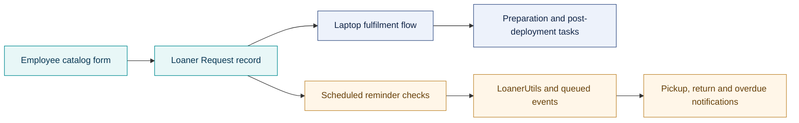

# Loaner Request

**A ServiceNow course project for requesting and tracking temporary equipment loans.**

I completed this application by following ServiceNow's guided labs, including the Automated Test Framework (ATF) exercise, and pushed the application from my training instance to GitHub. This is a learning project, rather than an independently designed product.

## The use case

An employee needs a device for a limited period. The application keeps the requester, selected equipment, loan dates and fulfilment tasks together, with configured reminders for collection, return and overdue items.

## What I practised

I worked through the lab configuration and scripts to understand how forms, server-side validation, fulfilment flows and scheduled reminders fit together. The repository also gave me practice using ServiceNow's instance-to-Git source control.

## How the configuration connects

This diagram describes the exported configuration; it is not a test execution record.

## Technical overview

| Component | Present in this export |
| --- | --- |
| Custom tables | Loaner Request and Loaner Task. |
| Record Producers | Catalog forms for creating loaner requests. |
| Client Scripts | Default the usage location from user details; set the item type for recognised device names. |
| Business Rules | Pass user location through `g_scratchpad` and reject an end date earlier than the start date. |
| UI Policy | Show and require the Other field when the relevant depot choice is selected. |
| Flow Designer | Active `Loaner Laptop` flow with preparation and post-deployment tasks, waits and state updates. |
| Script Include | `LoanerUtils` uses GlideRecord, reminder tracking fields and queued events. |
| Scheduled jobs and notifications | Three active reminder jobs and three event-based notifications: pickup, return and overdue. |
| Access controls | Application user/admin roles and ACL definitions. |
| ATF | `My First Loaner Request ATF Test` definition; no test steps or run results are included in the export. |

## Status and source

The application configuration is available in the [instance-generated application folder](2a5e633a086703107f4467af7c9ef16e/). This repository does not include a recorded demo or screenshots from my instance, and it does not establish production readiness or successful email delivery.

Two REST lab examples were sanitised to remove hard-coded credentials and password output. That changes two generated XML files; obtain a fresh, sanitised export from ServiceNow before attempting a checksum-compatible import. [Source review and remaining checks](docs/source-review.md).

## Official learning reference

**Reference video by ServiceNow Community, not my project demo.** Chuck Tomasi's 2020 session presents another version of the Loaner Request application. Its screens and features may differ from this export.

The public [Application Development Fundamentals answer guide](https://www.servicenow.com/community/s/cgfwn76974/attachments/cgfwn76974/training-certifications-kb/8346/3/ADF_AnswerGuide_U010.pdf) also describes the Loaner Request labs and ATF exercise. [Sources and image credit](docs/references.md).
